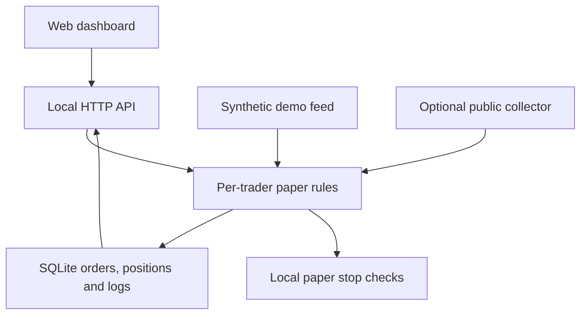

# CopyTrade Studio

[简体中文](README.zh-CN.md) · English

A local full-stack application for observing multiple Binance lead portfolios, configuring independent follow rules, and evaluating automated copy-trading ideas with a persistent **paper-trading** ledger.

**Version 0.1 is paper-only. It does not accept exchange credentials or place real orders.** The real-order prototype from the earlier command-line experiment is not exposed through this application's API.

## Why this project exists

When an official copy portfolio is full, a user may still want to study the trader's publicly available operations and evaluate a custom follow strategy. This project provides a workspace for that research. It does not bypass official follower capacity, grant access to hidden positions, or guarantee that public records are timely enough to trade.

## Features

- Chinese/English dashboard with trader selection and separate portfolio settings.
- Add multiple portfolio URLs. Viewing another trader does not pause existing collectors or transfer positions.
- Configurable paper budget, margin per opening, leverage, symbol allowlist, loss budget, entry expiry, price stop, fee assumptions and reduction fraction.
- **3% maximum adverse entry deviation by default for both long and short entries.** At a source price of 100, a long permits a quote up to 103 and a short down to 97. These are entry limits, not stop-loss percentages.
- SQLite persistence, duplicate-operation protection, isolated per-trader paper positions, fees and realized/unrealized P&L.
- Local paper stops, paper loss-budget exits and a global pause on new entries. Stops keep being checked for paused demo traders while the application is running.
- Distinct handling of stale entries and late closing signals. Late closes can reduce existing owned paper positions; they never open a reverse position.
- Signal logs with source-labelled timestamps, first-seen timestamps, observed delay, decision quote and adverse deviation; CSV and config exports.
- Offline demo with synthetic signals and prices. Optional visible-page public collector, subject to access rights, verified timezone and current page compatibility.
- Loopback-only HTTP server with Host checks, same-origin mutation checks, session CSRF tokens, request-size limits and escaped frontend rendering.

## Run locally

Requires Python **3.10+**. The dashboard, demo and backend use the Python standard library; **no npm or pip installation is required for the demo**.

```powershell
python -m backend.server
```

Open **http://127.0.0.1:8765**. On Windows, double-click `start.cmd` instead. Stop the server with Ctrl+C. Use `--port 8766` if the port is occupied.

1. Select a trader and click **Start paper following**.
2. The demo scheduler generates synthetic operations. You can also click **Generate demo signal**.
3. Use **Test 3% entry rejection** to generate an opening signal with a 5% adverse deviation.
4. Inspect positions, orders, signals and the activity log.
5. Pause a trader and close its paper positions before editing its parameters.

The prefilled trader name is a reference, not an assertion of identity verification. **All data in demo mode is synthetic, including when the displayed trader name is 熬鹰资本.** Initial amounts and leverage are demo settings, not recommendations.

## VS Code

Open `copytrade-studio.code-workspace`, or use **File → Open Folder** and select this project. Use **Terminal → Run Task → Start CopyTrade Studio / 启动应用** to start it. A Python debugger configuration is included for users who have the Python/debugger extensions installed.

## Optional public collector

```powershell
python -m venv .venv
.venv\Scripts\python.exe -m pip install -r requirements-collector.txt
.venv\Scripts\python.exe -m playwright install chromium
.venv\Scripts\python.exe -m backend.server
```

Before selecting `Public feed`, verify that automated retrieval of the source is permitted for your account and use, and establish the timezone of displayed operation timestamps. Enable the access checkbox only after that check. The collector does not log into Binance, bypass challenges, or access hidden positions. It reads the visible Chinese-language public operation list.

The first successful read becomes a historical baseline, not a set of opening orders. Subsequent unseen operations feed the **paper executor**, using public bid/ask quotes. History gaps or collection errors pause collection and are logged. The webpage has no verified fixed-delay SLA. Increasing polling frequency cannot remove upstream publication delay.

## Architecture



| Component | Responsibility |
|---|---|
| `frontend/` | Responsive UI, English/Chinese labels and parameter editor |
| `backend/server.py` | Static assets, JSON endpoints and local request boundaries |
| `backend/core.py` | Validation, deterministic paper execution and durable ledger |
| `backend/feeds.py` | Synthetic demo, optional public collection and scheduler |
| `tests/` | Domain scenarios and actual HTTP parsing through in-memory byte streams |
| `docs/` | API contract, operational limits and production integration work |

## Tests

```powershell
python -m unittest discover -s tests -v
node --check frontend/app.js
```

Node is optional and only needed for the second, syntax-check command. HTTP tests use `BaseHTTPRequestHandler` with a byte-stream socket so they can run without network access. They do not verify TCP, browser rendering or a live Binance integration. See [validation notes](docs/VALIDATION.md).

## Runtime and financial boundaries

- Paper fills use the best quoted price and assume sufficient liquidity. Order-book depth, funding fees, liquidations, exchange minimum order sizes and all real execution failures are not simulated.
- Stop settings refer to **price movement**, not leveraged return on margin. Local paper stops do not exist at the exchange and cannot protect real funds or run while this server is stopped.
- Closing percentages are user-defined reductions of this application's paper position. A source operation's quantity does not reveal its percentage of the trader's hidden total position.
- Signal hashes are an approximation when the page provides no durable trade ID. Public operation records can aggregate fills, arrive late or change format.
- A declared configuration budget is a paper allocation, not a separate exchange account. No trading account is connected.
- Only one local user/process should own a data directory. This is not a hardened internet-facing service, hosted multi-user product or investment recommendation.
- GitHub stores code. GitHub Pages cannot run this Python backend. Do not use a Codespace or GitHub Actions as an assumed permanent trading service.
- A production live executor needs separate implementation and online validation; see [production integration](docs/PRODUCTION.md).

## Repository hygiene

The ignore rules exclude runtime databases, logs, environments and credential files. Keep the repository private while reviewing it. No third-party data access rights or exchange credentials are included. Choose a license before offering public reuse.
